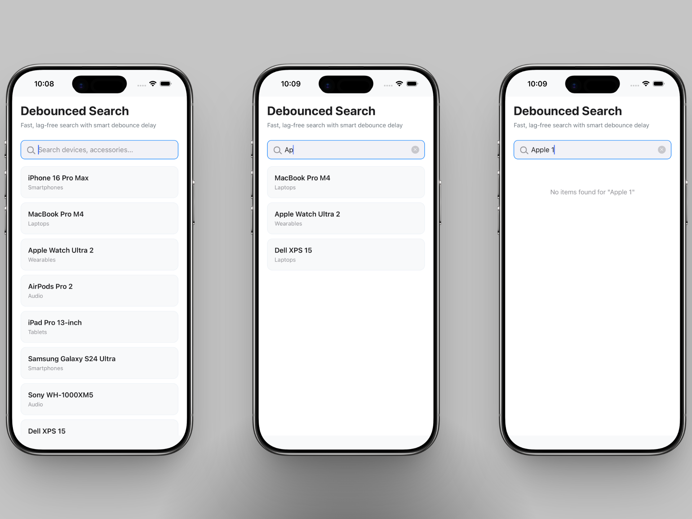

<div align="center">

# React Native Debounced Search

[](https://www.npmjs.com/package/@izonnet-web-solution/react-native-debounced-search)
[](https://www.typescriptlang.org/)
[](https://opensource.org/licenses/MIT)
[](https://reactnative.dev/)

**A lightweight, zero-dependency, and highly customizable React Native debounced search bar and hook with ready-made UI presets (iOS, Pill, Material, Outline).**

<br />



</div>

---

## ✨ Highlights

- ⚡️ **Zero External Runtime Dependencies:** Built 100% on pure React Native primitives. No vector icons, fonts, or SVG dependencies required.
- 🎨 **5 Ready-Made UI Presets (`variant`):** Professional styles out-of-the-box (`'pill'`, `'ios'`, `'material'`, `'outline'`, `'default'`).
- ⌨️ **Immediate Search on Enter:** Pressing keyboard Search/Enter executes the search query immediately without waiting for the debounce delay.
- ⏱️ **Configurable Debounce Delay:** Easily set delay timing (default: `500ms`).
- 🔤 **Smart `minLength` Support:** Prevents single-character spam calls while safely allowing 2-letter queries (like *HP*, *LG*, *Mi*, *TV*) on Enter.
- 🧹 **Built-in Clear (✕) Button:** Automatically appears when text is typed and resets the query with one tap.
- ⏳ **Built-in Loading Spinner:** Toggle an ActivityIndicator spinner directly inside the input container.
- 🔍 **Built-in Pure RN Icons:** Responsive search and clear icons rendered natively.
- 🪝 **Standalone `useDebounce` Hook:** Exported separately for custom input fields and forms.
- 📱 **Universal Platform Support:** Tested and optimized for iOS, Android, and React Native Web.

---

## 📦 Installation

```bash
# npm
npm install @izonnet-web-solution/react-native-debounced-search

# yarn
yarn add @izonnet-web-solution/react-native-debounced-search

# pnpm
pnpm add @izonnet-web-solution/react-native-debounced-search

# bun
bun add @izonnet-web-solution/react-native-debounced-search
```

---

## 🚀 Quick Start

### Basic Usage

```tsx
import React, { useState } from 'react';
import { View, StyleSheet, FlatList, Text } from 'react-native';
import { DebouncedSearch } from '@izonnet-web-solution/react-native-debounced-search';

export default function SearchScreen() {
  const [loading, setLoading] = useState(false);
  const [results, setResults] = useState<string[]>([]);

  const handleSearch = (query: string) => {
    if (!query.trim()) {
      setResults([]);
      return;
    }

    setLoading(true);
    console.log('Searching API for:', query);

    // Call your backend search API...
    setTimeout(() => {
      setResults([`Result for "${query}" #1`, `Result for "${query}" #2`]);
      setLoading(false);
    }, 300);
  };

  return (
    <View style={styles.container}>
      <DebouncedSearch
        placeholder="Search devices, accessories..."
        delay={500}
        loading={loading}
        onSearch={handleSearch}
      />

      <FlatList
        data={results}
        keyExtractor={(item) => item}
        renderItem={({ item }) => <Text style={styles.item}>{item}</Text>}
      />
    </View>
  );
}

const styles = StyleSheet.create({
  container: {
    flex: 1,
    padding: 16,
    paddingTop: 50,
    backgroundColor: '#FFFFFF',
  },
  item: {
    padding: 14,
    borderBottomWidth: 1,
    borderBottomColor: '#F0F0F0',
  },
});
```

### Ready-Made UI Presets (`variant`)

Switch styles instantly with **1 prop**:

```tsx
// 1. E-commerce Pill Shape with subtle shadow
<DebouncedSearch variant="pill" onSearch={handleSearch} />

// 2. Apple / iOS Native Search Bar
<DebouncedSearch variant="ios" onSearch={handleSearch} />

// 3. Android Material Style with accent bottom line
<DebouncedSearch variant="material" onSearch={handleSearch} />

// 4. Minimalist Bordered Outline
<DebouncedSearch variant="outline" onSearch={handleSearch} />

// 5. Classic Rounded Rectangle (Default)
<DebouncedSearch variant="default" onSearch={handleSearch} />
```

---

## 📖 Props Reference

| Prop | Type | Default | Description |
|---|---|---|---|
| `onSearch` | `(query: string) => void` | **Required** | Callback fired when debounced typing stops or keyboard Enter is pressed. |
| `variant` | `'default' \| 'ios' \| 'pill' \| 'material' \| 'outline'` | `'default'` | Pre-designed UI preset for instant professional styling. |
| `delay` | `number` | `500` | Delay in milliseconds before triggering `onSearch`. |
| `minLength` | `number` | `0` | Minimum character threshold before debounced search fires. |
| `value` | `string` | `undefined` | Controlled value for the input. |
| `defaultValue` | `string` | `''` | Initial value for uncontrolled input. |
| `loading` | `boolean` | `false` | Shows an ActivityIndicator spinner inside the input when true. |
| `showClearButton` | `boolean` | `true` | Shows clear (✕) button when text exists in the input. |
| `showSearchIcon` | `boolean` | `true` | Shows search icon on the left side. |
| `searchIcon` | `React.ReactNode` | Default Icon | Custom icon component for search icon. |
| `searchIconColor` | `string` | `'#8E8E93'` | Color of default search icon. |
| `searchIconSize` | `number` | `15` | Size of default search icon in points. |
| `clearIcon` | `React.ReactNode` | Default Icon | Custom icon component for clear button. |
| `leftComponent` | `React.ReactNode` | `undefined` | Custom slot rendered on the far left. |
| `rightComponent` | `React.ReactNode` | `undefined` | Custom slot rendered on the far right (filter, voice, etc.). |
| `onClear` | `() => void` | `undefined` | Callback fired when clear button is pressed. |
| `onChangeText` | `(text: string) => void` | `undefined` | Immediate callback on every single keystroke. |
| `containerStyle` | `StyleProp<ViewStyle>` | `undefined` | Style for the outermost wrapper view. |
| `inputContainerStyle` | `StyleProp<ViewStyle>` | `undefined` | Style for the search input box container. |
| `focusedInputContainerStyle` | `StyleProp<ViewStyle>` | `undefined` | Style applied to container when input is focused. |
| `inputStyle` | `StyleProp<TextStyle>` | `undefined` | Style for the `TextInput` element. |
| `clearButtonStyle` | `StyleProp<ViewStyle>` | `undefined` | Style for the clear button wrapper. |
| `placeholderTextColor` | `string` | `'#8E8E93'` | Color of placeholder text. |
| `activityIndicatorColor` | `string` | `'#007AFF'` | Color of loading spinner. |
| `disabled` | `boolean` | `false` | Disables user interaction. |
| `ref` | `React.Ref<DebouncedSearchRef>` | `undefined` | Forwarded ref to access imperative methods. |

*Supports all other standard React Native [`TextInputProps`](https://reactnative.dev/docs/textinput).*

---

## 🎨 Theming & Dark Mode

The component can easily adapt to Dark Mode or custom design systems:

```tsx
import { useColorScheme } from 'react-native';
import { DebouncedSearch } from '@izonnet-web-solution/react-native-debounced-search';

export function DarkSearch() {
  const isDarkMode = useColorScheme() === 'dark';

  return (
    <DebouncedSearch
      onSearch={(q) => console.log(q)}
      placeholder="Search in dark mode..."
      placeholderTextColor={isDarkMode ? '#8E8E93' : '#6C757D'}
      inputContainerStyle={{
        backgroundColor: isDarkMode ? '#1C1C1E' : '#F2F2F7',
        borderColor: isDarkMode ? '#2C2C2E' : '#E5E5EA',
      }}
      focusedInputContainerStyle={{
        borderColor: '#007AFF',
      }}
      inputStyle={{
        color: isDarkMode ? '#FFFFFF' : '#000000',
      }}
    />
  );
}
```

---

## 🪝 Standalone `useDebounce` Hook

Use the built-in hook in custom search inputs, autocomplete dropdowns, or forms:

```tsx
import React, { useState, useEffect } from 'react';
import { TextInput, View, Text } from 'react-native';
import { useDebounce } from '@izonnet-web-solution/react-native-debounced-search';

export function CustomSearchInput() {
  const [text, setText] = useState('');
  const debouncedQuery = useDebounce(text, 400);

  useEffect(() => {
    if (debouncedQuery) {
      console.log('Search triggered for:', debouncedQuery);
    }
  }, [debouncedQuery]);

  return (
    <View>
      <TextInput
        value={text}
        onChangeText={setText}
        placeholder="Type here..."
      />
      <Text>Debounced Query: {debouncedQuery}</Text>
    </View>
  );
}
```

---

## 🕹️ Imperative Ref API (`DebouncedSearchRef`)

```tsx
import React, { useRef } from 'react';
import { View, Button } from 'react-native';
import { DebouncedSearch, DebouncedSearchRef } from '@izonnet-web-solution/react-native-debounced-search';

export function SearchControls() {
  const searchRef = useRef<DebouncedSearchRef>(null);

  return (
    <View>
      <DebouncedSearch ref={searchRef} onSearch={(q) => console.log(q)} />
      
      <Button title="Focus" onPress={() => searchRef.current?.focus()} />
      <Button title="Blur" onPress={() => searchRef.current?.blur()} />
      <Button title="Clear" onPress={() => searchRef.current?.clear()} />
      <Button title="Set Query" onPress={() => searchRef.current?.setValue('iPhone')} />
    </View>
  );
}
```

---

## 👨‍💻 Author

**Nilesh Ahir**  
* Organization: [Izonnet Web Solution](https://github.com/Izonnet-Web-Solution)

---

## 📄 License

This project is licensed under the MIT License - see the [LICENSE](LICENSE) file for details.
